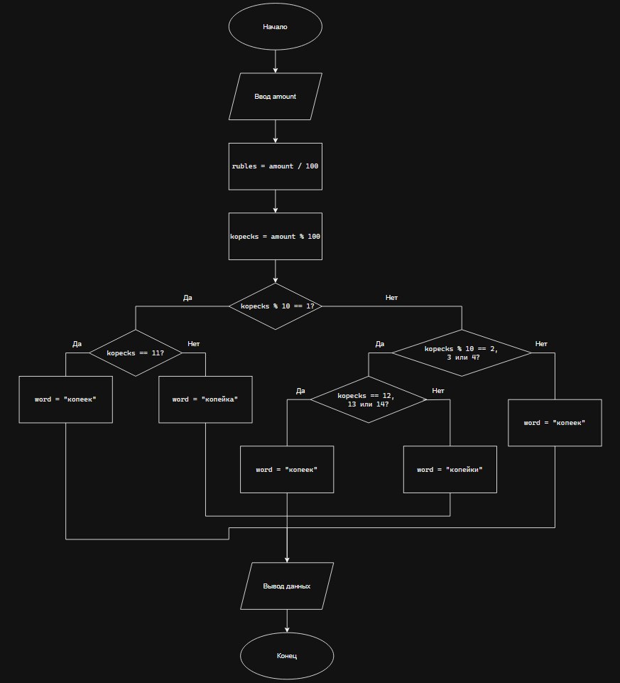

# Домашнее задание к работе 7

## Условие задачи
Написать программу, которая для заданной стоимости покупки в копейках выводить текстовое сообщение, отображающие значение в рублях и копейках с правильным склонением слова «копейка».

## 1. Алгоритм и блок-схема

### Алгоритм
1. **Начало**
2. Ввод суммы в копейках
3. Расчет рублей
  - `rubles` = `amount` / 100
4. Расчет копеек
  - `kopecks` = `amount` % 100
5. Проверка случая 1: сумма копеек заканчивается на 1
  - В случае с "11" константе `word` присваивается "копеек"
  - В остальных случаях константе `word` присваивается "копейка"
6. Проверка случая 2: сумма копеек заканчивается на 2, 3 или 4
  - В случае с "12", "13", "14" константе `word` присваивается "копеек"
  - В остальных случаях константе `word` присваивается "копейки"
7. Во всех остальных случаях константе `word` присваивается "копеек"
8. Вывод результата
9. **Конец**

### Блок-схема
 

## 2. Реализация программы

```
#define _CRT_SECURE_NO_WARNINGS
#include <stdio.h>
#include <locale.h>

int main() {
	setlocale(LC_CTYPE, "RUS");

	int amount, rubles, kopecks;
	const char* word;
	

	printf("Введите сумму в копейках\n");
	scanf("%d", &amount);

	rubles = amount / 100;
	kopecks = amount % 100;

	switch (kopecks % 10) {

	case 1:

		switch (kopecks) {
		case 11: word = "копеек"; break;
		default: word = "копейка"; break;

		}
		break;

	case 2:
	case 3:
	case 4:

		switch (kopecks) {
		case 12: 
		case 13:
		case 14: word = "копеек"; break;
		default: word = "копейки"; break;

		}
		break;

	default: word = "копеек";

	}

	printf("Сумма: %d руб. %d %s", rubles, kopecks, word);

	return 0;
}
```

## 3. Результаты работы программы

1. **Вывод с "копейка"**

```
Введите сумму в копейках
541
Сумма: 5 руб. 41 копейка
```

2. **Вывод с "копеек"**

```
Введите сумму в копейках
12
Сумма: 0 руб. 12 копеек
```

3. **Вывод с "копейки"**

```
Введите сумму в копейках
64642
Сумма: 646 руб. 42 копейки
```

## 4. Информация о разработчике

Лупачев Сергей бТИИ-262
